# AI & Full-Stack Developer | Next.js, React.js, Node.js, Postgres, Python

  📞 Beyond my professional interests, I also value building connections and making friends within the tech community. If you share a similar passion for technology and are interested in connecting with me, please feel free to send me a direct message.

  🚀 <strong>Confidently in the direction of your dreams. Live the life you have imagined.</strong>

  Work guarantee 🎖️ | Quick answers ⚡️ | Always quality work ✅ | 3+ Years Experience 💻 | Full Stack Engineer | Scalable Web App Specialist

  
  

---

## 👨‍💻 About Me

I'm **Danial Fakhrabadi**, a passionate **AI & Full-Stack Developer** focused on building modern, scalable, and production-ready web applications.

I enjoy working on the full lifecycle of a product — from building responsive frontends and powerful backend systems to designing databases, creating REST APIs, deploying apps, and improving performance.

- 💻 Full-Stack Developer with a focus on modern web technologies
- 🧠 Interested in **LLM applications**, scalable software, and clean architecture
- ⚙️ Building robust backend systems with **Node.js, Express.js, Django, and DRF**
- 🎨 Creating responsive frontend experiences with **React.js, Next.js, and Tailwind CSS**
- 🗄️ Working with **MySQL** and **PostgreSQL** for reliable data management
- 🐳 Familiar with **Docker, Linux, Vercel**, and deployment workflows
- 🤝 Open to freelance work, collaborations, and networking opportunities

---

## 🧠 TECH STACK

### 🔥 Major Programming Languages

  

### 🎨 Frontend Frameworks and Skills

  

### ⚙️ Backend Development

  
  
  

### 🗃️ Databases

  

### 🛠️ Other Essentials

  

---

## 💼 SERVICES

- Custom Web App Development (Frontend & Backend)
- Modern Website Development
- REST API Design & Integration
- Full-stack Architecture Design & Maintenance
- Database Design & Optimization
- Authentication & Secure Access
- Docker & Deployment Workflows
- Responsive UI Development
- Performance Optimization & Scalability

---

## 🌍 INDUSTRIES SERVED

**Real Estate | SaaS | eCommerce | Healthcare | Education | Entertainment | Startups & Enterprises**

---

## 💡 WHY CHOOSE ME

1. Clean, maintainable, and production-ready code
2. Strong problem-solving and communication skills
3. Scalable architecture and optimized performance
4. Agile development and quick turnaround
5. End-to-end project ownership with post-launch support

---

## 📌 Current Focus

- Building scalable full-stack applications
- Developing API-driven platforms
- Improving backend performance and architecture
- Exploring AI / LLM-based product ideas
- Expanding production-level engineering practices

---

## 📊 GitHub Stats

  
  

---

## 🤝 Let's Connect

Let's build something exceptional — from MVPs to scalable production platforms.

- 🐙 **GitHub:** [github.com/danial137](https://github.com/danial137)
- 💼 **LinkedIn:** [Danial Fakhrabadi](https://www.linkedin.com/in/danial-fakhrabadi-334a33436/)

---

### Thanks for visiting my profile ⭐

**Keep learning. Keep building. Keep moving forward.**

